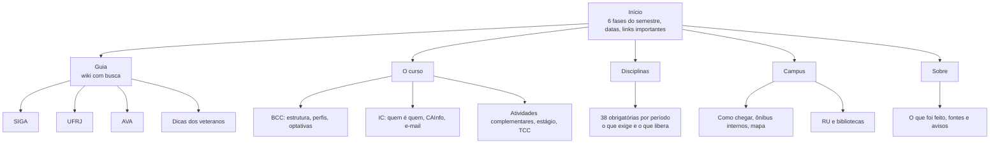
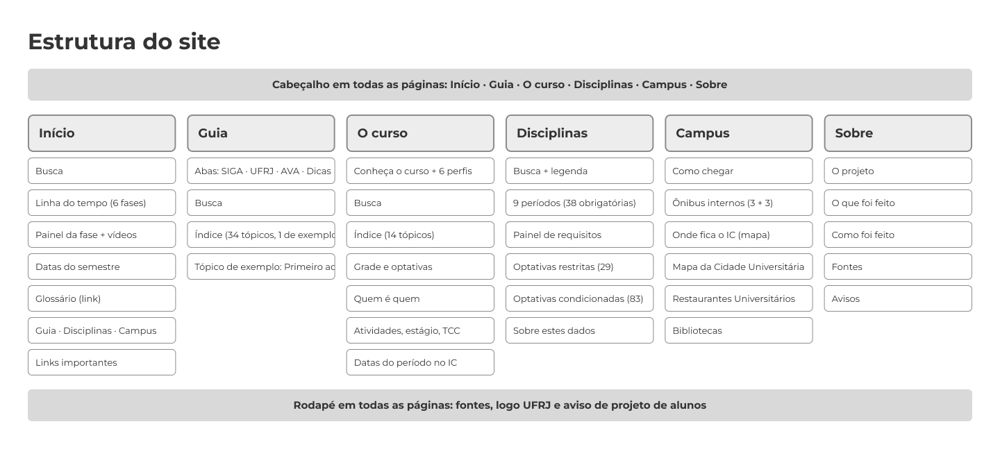

# Calouro BCC

Site de apoio para calouros do Bacharelado em Ciência da Computação (BCC) da UFRJ.
Trabalho da disciplina **Habilidades Sociais para o Trabalho (ICP145)**.

Site no ar: https://calouro-bcc-ufrj.vercel.app

Código: https://github.com/williand3v/calouro-bcc-versao-final

Documentos em PDF (também na página Sobre): [Conteúdo do site](arquivos/conteudo-do-site.pdf) e [Como levantamos as informações](arquivos/como-levantamos-as-informacoes.pdf)

Wireframe no Figma: https://www.figma.com/proto/OB16bBApcPuEbbSfHYMzXH/Calouro-BCC-UFRJ---Wireframe-do-site?node-id=5-632&t=U0WhMc27zTstbilz-1


## O que tem no site

| Página | Arquivo | O que faz |
|---|---|---|
| Início | `index.html` | Linha do tempo com as 6 fases do semestre e o que fazer em cada uma |
| Guia | `guia.html` | Wiki com busca: SIGA, inscrição, trancamento, documentos, bolsas, RU e mais. Tem abas: SIGA, UFRJ, AVA e Dicas dos veteranos, e vídeos dentro de cada assunto |
| Disciplinas | `disciplinas.html` | Todas as matérias do BCC. Ao clicar numa, mostra o que ela exige e o que libera |
| Campus | `campus.html` | Ônibus internos, mapas, restaurantes universitários e bibliotecas |
| O curso | `curso.html` | O BCC e o IC: estrutura do curso, perfis, optativas, quem é quem, atividades complementares, estágio, TCC, CAInfo, e-mail do IC e datas |
| Sobre | `sobre.html` | O que foi feito, como foi feito e as fontes |

## Estrutura do site

Todas as páginas têm o mesmo menu no topo e levam umas às outras.



Wireframe do mapa (exportado do Figma):



## Como rodar

O site é feito só com HTML, CSS e JavaScript simples. Não precisa instalar nada.

- **Mais fácil:** abra o arquivo `index.html` no navegador.
- **Com servidor local** (para testar como no site publicado):

```bash
python -m http.server 8000
```

Depois abra http://localhost:8000. O mapa, as fontes de letra e os vídeos precisam de internet.

## Como o código está organizado

```
index.html, guia.html, ...   uma página por arquivo (o JavaScript de cada página fica no fim dela)
style.css                    todo o visual, dividido em seções comentadas
fases.js, busca.js           lógica da home (fase pela data, busca no site); testes em *.test.js (rode: node --test)
img/                         logos da UFRJ e do IC e o mapa oficial da Cidade Universitária
arquivos/                    PDFs para baixar (manual do SIGA e guia da PR7)
vercel.json                  deixa os endereços sem ".html" no Vercel
FONTES-E-MATERIAIS.md        todas as fontes usadas, com links
```

Onde mexer:

- **Textos e links:** direto nos arquivos `.html`.
- **Cores e fonte:** no começo de `style.css` (seção "Variáveis e base").
- **Fases do semestre:** na lista `phases`, no JavaScript de `index.html`.
- **Disciplinas:** na lista `D`, no JavaScript de `disciplinas.html`.
- **Pontos do mapa:** na lista `PONTOS`, no JavaScript de `campus.html`.

## Publicação

O site é estático e foi publicado no [Vercel](https://vercel.com/). Para publicar de novo:

```bash
npx vercel deploy --prod
```

## Fontes e créditos

- Conteúdo: Manual do Aluno do SIGA, Manual do Calouro UFRJ, páginas da UFRJ, do Instituto de Computação e da Prefeitura Universitária. A lista completa está em [FONTES-E-MATERIAIS.md](FONTES-E-MATERIAIS.md).
- Logos, cores (Azul UFRJ `#003366`) e fonte (Montserrat): guia de identidade visual da UFRJ. As marcas pertencem à UFRJ e ao Instituto de Computação.
- Mapa clicável: [Leaflet](https://leafletjs.com/) e [OpenStreetMap](https://www.openstreetmap.org/).
